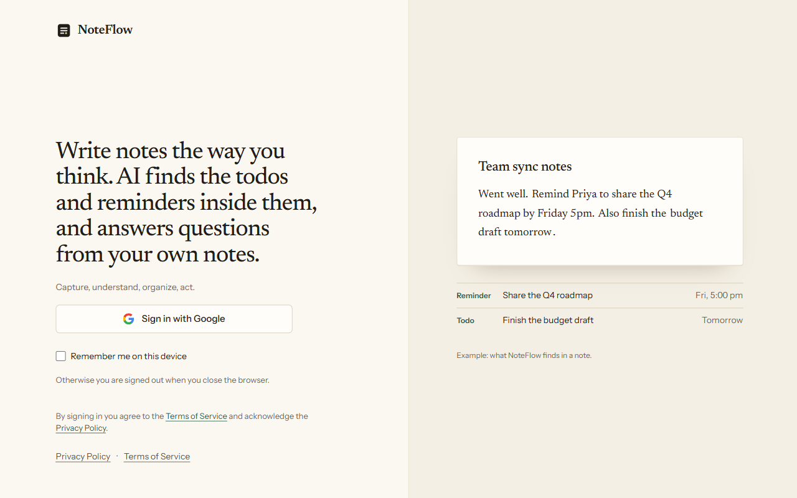
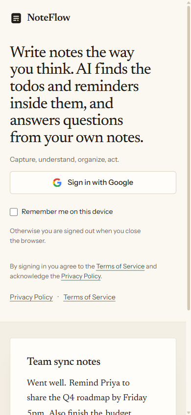
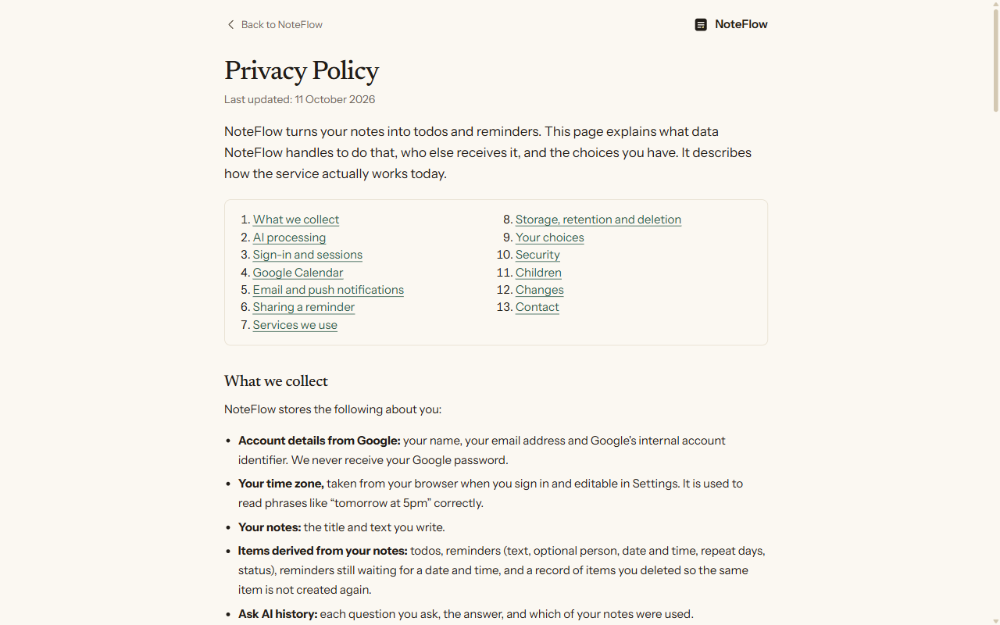
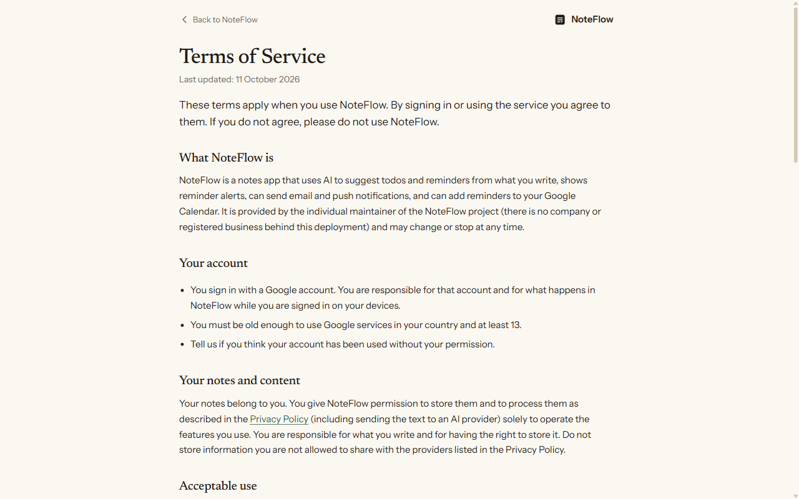
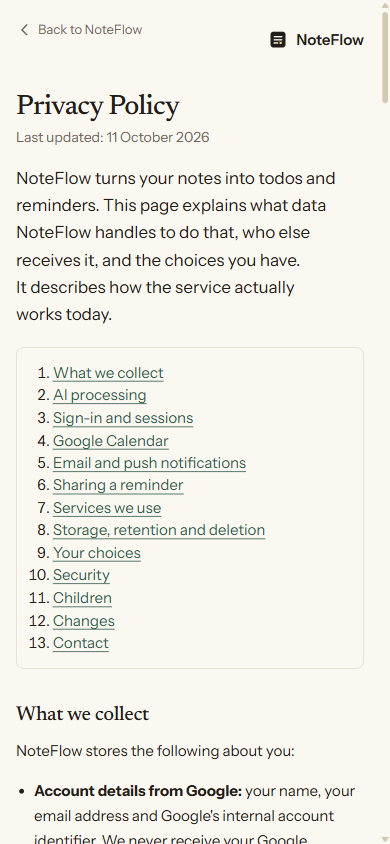
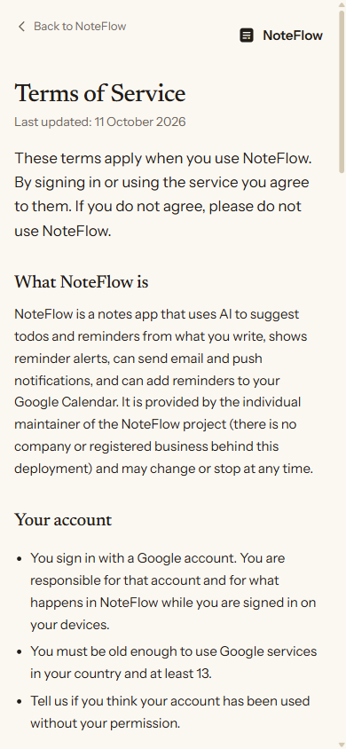
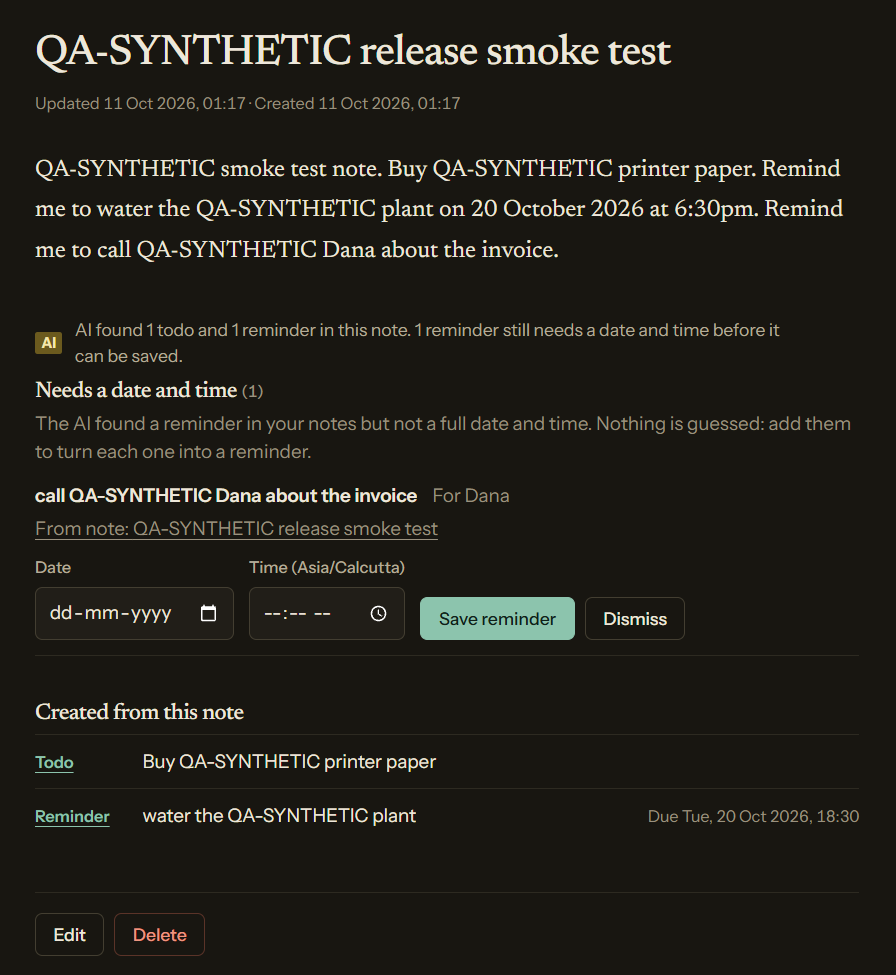
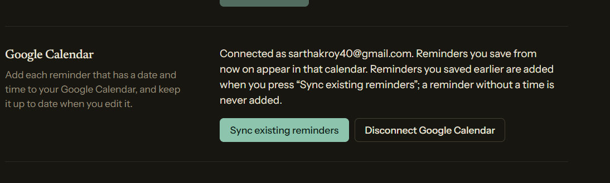
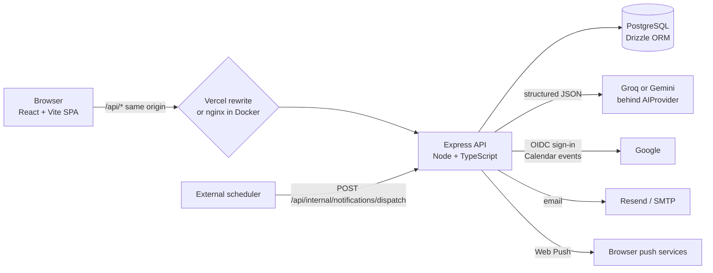

# NoteFlow

AI notes, todos and reminders. Write notes in plain language; an AI model finds the todos and
reminders inside them, and you can ask questions about your own notes. Sign in with Google.

- **Live app:** <https://noteflow-olive.vercel.app> (frontend on Vercel, API and PostgreSQL on Render)
- **Source:** <https://github.com/SarthakRoy-1/NoteFlow>
- **Public pages:** [`/privacy`](https://noteflow-olive.vercel.app/privacy) and
  [`/terms`](https://noteflow-olive.vercel.app/terms) (see [Privacy, security and limitations](#15-privacy-security-and-limitations))

> **Reading this README.** Each feature below is marked **Implemented**, **Optional** (needs
> configuration), **External** (depends on a third-party account or setting) or **Unverified**
> (code and automated tests exist, but it has not been proven against the real service). Nothing in
> this document is marked verified unless it was actually run.

## Table of contents

1. [Project overview](#1-project-overview)
2. [Feature overview](#2-feature-overview)
3. [Screenshots and visual tour](#3-screenshots-and-visual-tour)
4. [Architecture](#4-architecture)
5. [Technology stack](#5-technology-stack)
6. [Repository structure](#6-repository-structure)
7. [Prerequisites](#7-prerequisites)
8. [Run on another system with Docker](#8-run-on-another-system-with-docker)
9. [Local development without Docker](#9-local-development-without-docker)
10. [Authentication and integrations](#10-authentication-and-integrations)
11. [API documentation](#11-api-documentation)
12. [Database and migrations](#12-database-and-migrations)
13. [Testing and quality gates](#13-testing-and-quality-gates)
14. [Deployment](#14-deployment)
15. [Privacy, security and limitations](#15-privacy-security-and-limitations)
16. [Troubleshooting](#16-troubleshooting)
17. [Contributing and license](#17-contributing-and-license)

---

## 1. Project overview

**What it is.** NoteFlow is a web app for people who jot things down and then forget to act on them.
You write a note ("Remind Priya to share the Q4 roadmap by Friday 5pm. Also finish the budget draft
tomorrow."). NoteFlow saves it, asks an AI model what todos and reminders it contains, checks the
answer against the note, and files them as real todos and reminders with the right dates in your own
time zone.

**The problem it solves.** Action items hide inside free-form text. NoteFlow keeps the note as the
source of truth and derives the actions from it, without making you retype them, and never invents
a time that the note did not state.

**Target users.** Individuals who keep running notes (meetings, calls, planning) and want todos and
timed reminders extracted automatically, with alerts in the browser, by email or by push.

**Key differentiators.**

- The note is always saved first. An AI failure never loses or blocks a note.
- The backend is the authority: every AI answer is schema-validated, quote-checked against the
  note and date-resolved in the user's time zone before anything is stored.
- A reminder always has a valid date **and** a time. Anything less is kept as a **pending
  reminder** the user completes, never guessed.
- Re-analysing a note never creates duplicates, and never resurrects something you deleted or
  edited.
- Per-user data isolation: every query is scoped to the signed-in user.

**Current implementation status.** All Core and Should-have items of the assignment are implemented.
The app is deployed (Vercel + Render) and the release in commit `4a8d503` (Google Calendar
synchronization with "Sync existing reminders", pending reminder drafts, the Privacy Policy and
Terms pages, migration `0007`) was verified live on 11 October 2026 (IST). See
[Deployment](#14-deployment) for exactly what was and was not verified.

---

## 2. Feature overview

| Feature | Status | Notes |
| --- | --- | --- |
| Google sign-in (OAuth 2.0 / OIDC, PKCE, state, nonce) | **Implemented**, **External** | Needs a Google OAuth client. Server-side sessions in PostgreSQL, HttpOnly cookie, optional "Remember me". |
| Email/password sign-in | Disabled by default | Exists in code behind `ENABLE_PASSWORD_AUTH=true`; the assignment forbids a custom password login, so it is off and returns 404. Do not enable it for the assignment. |
| Notes (create, edit, delete, list, search by selection) | **Implemented** | Full CRUD, scoped to the user. |
| AI analysis of notes into todos and reminders | **Implemented**, **External** | Groq (default in production) or Gemini behind an `AIProvider` interface. Without a key the app runs and says "AI analysis is not set up". |
| Todos | **Implemented** | Open/done, due dates, edit, delete. AI-created todos do not come back after deletion. |
| Reminders and recurring reminders | **Implemented** | One-off, or repeating on chosen weekdays at a time of day; wall clock kept across daylight-saving changes. |
| Pending reminder drafts | **Implemented**, **Verified in production** | An AI reminder without a valid date and time is kept as a draft ("Needs a date and time"). It never alerts and never reaches the calendar until the user completes it. |
| In-app alerts | **Implemented** | A banner and count badge for due reminders while the app is open. |
| Email and Web Push notifications | **Optional**, **External** | Needs Resend/SMTP and VAPID keys. Verified in production: one real email to the Resend account owner; push accepted by the browser push service. Showing the notification on a device was not confirmed. |
| Notification scheduler | **Implemented**, **External** | In-process poller (every 60 s while the host is awake) plus an authenticated external trigger endpoint. See [scheduler behaviour](#reminder-notifications-and-the-scheduler). |
| Sharing a reminder with another NoteFlow user | **Implemented** | By verified account email, up to 10 people. |
| Ask AI (questions about your notes) | **Implemented**, **External** | Retrieval is keyword based (PostgreSQL full text), answers carry their source notes. |
| Google Calendar integration | **Optional**, **External**, **Verified in production** | Separate consent from sign-in. Automated tests use a mocked Google client; in addition one real Google consent, event create, update, delete and disconnect was run on production with a test account (see [Google Calendar](#google-calendar)). The Google OAuth app is in Testing mode. |
| Sync existing reminders | **Implemented**, **Verified in production** | Settings action that sends reminders saved before connecting, in small idempotent batches; a repeat press creates nothing new. |
| Settings (time zone, notifications, calendar, close button) | **Implemented** | Time zone is an IANA id stored per user. |
| Privacy Policy and Terms of Service | **Implemented**, **Verified in production** | Public, no sign-in, at `/privacy` and `/terms`; linked from the sign-in page and Settings. |
| Docker | **Implemented**, **Verified** | `docker compose up --build` builds and starts PostgreSQL + API + web; verified from a clean example configuration on 11 October 2026 (IST). See [section 8](#8-run-on-another-system-with-docker). |

### How AI analysis works

Saving a note stores it first, then asks the AI which todos and reminders it contains. The reply must
be JSON matching a strict schema. The backend then checks that every item is quoted from the note,
resolves dates in the **user's time zone**, and only then writes todos and reminders for that user
and note. If the AI is unavailable, slow, rate-limited or returns garbage, the note is still saved
and shows a clear message with a **Retry analysis** button. Re-saving an unchanged note never calls
the AI or creates duplicates. Re-analysis also recognises a **reworded** copy of something you
edited, completed or deleted (by its words, strictly) and does not add it again. Something that
repeats ("every Monday at 9am", "every weekday") becomes one repeating reminder; unsupported
repetitions (every other week, monthly, hourly) stay one-off rather than being guessed.

Tests never call a real AI provider; they use a scripted fake. To check a real provider by hand run
`npm run ai:smoke -w backend` (2 requests; add `-- --all` for 5).

Each user may make 4 AI calls a minute (note analysis and Ask AI share it), per process.

### Reminders need a date and time

A reminder is only saved when it has a valid date **and** a time of day. If the AI finds a reminder
that lacks either ("remind John about the invoice", "on Friday", "every Monday"), the note is saved
as usual and the item is kept as a **pending reminder** (table `reminder_drafts`):

- it never alerts and never reaches the calendar;
- it appears on the Reminders page and on its note under "Needs a date and time", with the date the
  note stated pre-filled (never a time);
- the user supplies the time (and date if needed); the server validates it in the user's time zone
  and rejects a missing, malformed, impossible or past value (`POST /api/reminder-drafts/:id/complete`);
  a repeating draft needs only a time;
- completing is one locked transaction, so a double submit creates one reminder;
- dismissing leaves a tombstone so re-analysis does not bring the same draft back;
- `PATCH /api/reminders/:id` cannot clear a reminder's date or reduce it to a date without a time.

Reminders created before this rule that have no time stay visible under "No time set", can still be
edited or deleted, and are **never** sent to Google Calendar.

### Reminder alerts

While the app is open, a banner (and a count badge on the Reminders link) lists every reminder that
is pending and whose time has arrived. The server decides using its clock; the browser re-checks
every 30 seconds, when the tab regains focus and at the exact moment the next reminder is due. The
alert stays until you press **Got it**. A date-only legacy reminder alerts from the start of that day
in your time zone; no clock time is invented.

**Repeating reminders** repeat on chosen weekdays (every day, weekdays, or a set such as Monday and
Thursday) at a time, kept on the wall clock of your time zone. `dueAt` is always the next occurrence.
**Got it** moves a due occurrence to the next one strictly after now.

**Sharing.** Press **Share** on a reminder and enter the email of another NoteFlow (Google) account.
The server resolves it to a real, verified account. The recipient sees the text, time and repeat
rule under **Shared with you**, never the source note, and acknowledges it themselves. Share attempts
are limited to 10 a minute.

### Reminder notifications and the scheduler

In-app alerts need the app open. Email and Web Push reach you when it is not.

- **What is sent.** When a reminder comes due, its owner and everyone it was shared with get one email
  and one push per device, per their own preferences. A repeating reminder notifies once per
  occurrence. Nothing is sent for a deleted, acknowledged or moved reminder, or for an occurrence
  older than 3 hours (an outage never floods anyone).
- **Preferences** (Settings): email on/off (default on), push on/off (default on, but a device only
  receives push after you enable it on that device), and "show the reminder text in the notification"
  (default **off**: a push says only that a reminder is due).
- **Delivery is durable.** One row per (reminder, person, channel, occurrence) in
  `notification_deliveries`, protected by a unique key, claimed with `FOR UPDATE SKIP LOCKED`,
  re-checked immediately before sending and retried with backoff (1, 5, 15, 60 minutes, five
  attempts). Only status codes are stored, never reminder text or addresses.
- **Scheduler.** The API polls every `NOTIFICATIONS_POLL_SECONDS` (default 60), but **a free Render
  instance sleeps when idle and a sleeping process cannot poll**. To deliver while it sleeps, call
  `POST /api/internal/notifications/dispatch` with `Authorization: Bearer <NOTIFICATIONS_CRON_SECRET>`
  every 1 to 5 minutes from an external scheduler (cron-job.org, a Render cron job). The repository
  also contains `.github/workflows/dispatch-notifications.yml`; GitHub scheduled workflows are
  best-effort and in this project's history it never fired, so do not rely on it alone.
- **Email.** Resend (`EMAIL_PROVIDER=resend`) or SMTP. With Resend's shared sandbox sender
  (`onboarding@resend.dev`) mail is delivered **only to the Resend account owner**; sending to other
  users needs a domain verified in Resend. Render's free plan blocks outbound SMTP.
- **Web Push.** Generate a VAPID key pair once (`npx web-push generate-vapid-keys`) and set the three
  `VAPID_*` variables. Users press **Enable notifications on this device**. Subscriptions are per
  account and device; a browser profile belongs to whoever enabled it last.

### Google Calendar

Optional, and separate from signing in (sign-in only requests `openid email profile`).

1. In Settings, **Connect Google Calendar** sends the user to Google's consent screen requesting only
   the Calendar permission (default `https://www.googleapis.com/auth/calendar.events.owned`, set by
   `GOOGLE_CALENDAR_SCOPE`). Nothing is requested until the user clicks.
2. The callback is the existing `GOOGLE_REDIRECT_URI`. It checks a signed, short-lived cookie
   (state, PKCE verifier, nonce) **bound to the signed-in user**, that the Google account is the one
   they are signed in with (verified email), and that the grant really contains the Calendar scope
   (the consent screen lets users untick it). Otherwise nothing is stored.
3. Only a refresh token is kept, encrypted with AES-256-GCM (key derived from `SESSION_SECRET`) in
   `google_calendar_connections`. It is never sent to the browser or logged.
4. For a reminder with a date and time that is saved or edited while connected, NoteFlow creates one
   event on the **primary** calendar (30 minutes, the user's time zone, a weekly `RRULE` for repeating
   reminders). The event id is the reminder id without dashes, so a retry updates the same event and
   can never create a second one. Edits update it; deleting the reminder or its note deletes it.
5. **Sync existing reminders** (Settings) sends reminders saved before connecting (and ones that
   failed earlier, or whose time zone changed). It handles only the signed-in user's pending
   reminders that have a real date and time and are upcoming or repeating, 25 per request, repeated
   safely. Pending drafts, reminders without a time and past one-off reminders are never sent.
6. Failures never block saving a reminder. A refused or revoked permission shows "needs reconnect"
   in Settings. A temporary failure leaves the reminder saved and is retried by the next edit or by
   pressing **Sync existing reminders**. Event deletion is **best effort**: if Google is unreachable
   when a reminder is deleted, the event can be left behind in the calendar.
7. **Disconnect** deletes the stored token, asks Google to revoke the grant and stops syncing. Events
   already in the calendar are not removed.

**What was verified, and how.** The behaviour is covered by automated tests against a mocked Google
client. In addition, on 11 October 2026 a real run was made on production with the owner's test
account and synthetic `QA-SYNTHETIC` notes: Google's consent screen showed "See, create, change,
and delete events on Google calendars you own"; connecting succeeded; **Sync existing reminders**
created exactly two events at the right local times (confirmed in Google Calendar); a second press
reported everything up to date and created nothing new; editing a reminder's time moved the same
event; deleting a reminder and deleting a note removed their events; **Disconnect** removed the
stored connection. The test data was then deleted.

**Not independently observed.** That Google actually honoured the revoke request on disconnect (the
code calls it and removes the local token), and behaviour for users other than the one test account.
While the Google OAuth app is in "Testing" status the consent screen says "Google hasn't verified
this app", only listed test users can connect, and Google expires refresh tokens after about 7 days,
which shows as "needs reconnect". See [section 10](#10-authentication-and-integrations).

### Ask AI

Ask a question about your own notes on the **Ask AI** page. The server (never the browser or the
model) picks the notes: it searches only your notes with the PostgreSQL full-text index, ranks them,
and sends at most 5 (each cut to 4,000 characters) with your question to the AI. The answer is
validated (`{ answer, answerable, used_notes }`) and saved with its sources. If no note matches, the
answer is "not enough information" and the AI is not called. Notes and questions are treated as
untrusted data (delimited by a random per-request marker and declared as data in the system prompt).
History (last 50, newest first) is private to you.

---

## 3. Screenshots and visual tour

All images below are real captures of the running application (a local production-equivalent dev
server), taken during release preparation. No mock-ups.

### Sign-in



**Sign-in (desktop).** Google sign-in, the "Remember me on this device" option, a worked example of
what NoteFlow finds in a note, and links to the Privacy Policy and Terms.



**Sign-in (narrow / phone width).** The same page at 390 px wide: one column, no horizontal scroll.

### Privacy Policy and Terms of Service



**Privacy Policy (desktop).** Public at `/privacy`: what is collected, AI processing, sessions,
the separate Google Calendar consent and its permission, notifications, retention and deletion.



**Terms of Service (desktop).** Public at `/terms`: acceptable use, AI limits, reminder reliability,
calendar integration, availability and liability.



**Privacy Policy (phone width).** The table of contents becomes a single column.



**Terms of Service (phone width).**

### Signed-in screens



**Note with AI analysis and a pending reminder (production).** A synthetic note with a todo, a timed
reminder and a reminder that has no date or time. The first two were created; the third is kept
under "Needs a date and time" and nothing is guessed.



**Settings, Google Calendar connected (production).** The connected state with the "Sync existing
reminders" and "Disconnect Google Calendar" actions.

Other signed-in pages (Todos, Reminders, Ask AI, the full Settings page) are not shown: the
application lists the owner's own notes there, and no screenshot with private content is published.

---

## 4. Architecture



- **Frontend.** React 18 + Vite + TypeScript, `react-router` (routes: `/login`, `/privacy`, `/terms`,
  and behind sign-in `/notes`, `/notes/new`, `/notes/:id`, `/todos`, `/reminders`, `/ask`,
  `/settings`), TanStack Query for server state. A service worker (`/sw.js`) shows push notifications.
- **Backend.** Express 5 + TypeScript. Routers per module under `backend/src/modules`, plus `auth`,
  `calendar`, `notifications`, `reconcile` (turns validated AI items into rows without duplicates),
  and `ai` (provider interface, prompts, schemas, validation). Zod validates every request body,
  parameter and AI response.
- **Database.** PostgreSQL via Drizzle ORM. Migrations are plain SQL in `backend/drizzle`, applied
  by `node backend/dist/db/migrate.js` before the server starts.
- **Authentication and sessions.** Google OIDC authorization-code flow with PKCE, state and nonce
  in a signed 10-minute cookie. The session token is random, only its SHA-256 hash is stored, and
  it lives in an HttpOnly, SameSite=Lax cookie (Secure in production). An origin check protects
  state-changing requests; there is no CORS layer because the browser stays same-origin.
- **AI provider.** `AIProvider` interface with Groq and Gemini implementations; `AI_PROVIDER`
  selects one, and a chosen but incomplete provider never silently falls back to the other.
- **Reminder scheduler.** A dispatcher enqueues, claims, sends and records notification deliveries
  in `notification_deliveries`; triggered by an in-process poller and/or the authenticated endpoint.
- **Calendar.** `CalendarSync` mirrors reminders to Google through one HTTP client module; it never
  throws into the request path.
- **Deployment.** Vercel serves the static frontend and rewrites `/api/*` to the Render API; Render
  PostgreSQL stores the data. Docker Compose reproduces the same shape locally (nginx plays Vercel).
- **Data flow for a note.** Browser → `POST /api/notes` → note stored → AI called → response parsed,
  schema-validated, quote-checked, date-resolved → `reconcile` writes todos/reminders/drafts in one
  transaction → calendar sync (if connected) after commit → UI refetches.

---

## 5. Technology stack

| Area | Technology | Role |
| --- | --- | --- |
| Frontend | React, Vite, TypeScript, TanStack Query, react-router | SPA, routing, server state |
| Backend | Node.js (>= 20.12), Express 5, TypeScript | HTTP API |
| Database | PostgreSQL, Drizzle ORM, drizzle-kit | Storage, SQL migrations |
| Validation | Zod | Request and AI-output validation |
| Dates | Luxon | Time-zone-correct date resolution |
| Auth | openid-client | Google OIDC with PKCE |
| AI | Groq (`openai/gpt-oss-120b` default) or Google Gemini | Note analysis and Ask AI |
| Notifications | `web-push`; Resend (HTTP API) or SMTP via `nodemailer` | Push and email |
| Tests | Vitest, supertest, Testing Library | Unit, integration and UI tests |
| Quality | ESLint, Prettier, TypeScript strict | Static checks |
| Hosting | Vercel (frontend), Render (API + PostgreSQL), Docker + nginx (local) | Deployment |

---

## 6. Repository structure

```text
.
├── backend/
│   ├── src/
│   │   ├── ai/            provider interface, Groq/Gemini, prompts, schemas, validation
│   │   ├── auth/          Google OIDC, sessions, cookies, (disabled) password auth
│   │   ├── calendar/      Google Calendar client, sync service, token encryption, routes
│   │   ├── config/        environment parsing (env.ts)
│   │   ├── db/            Drizzle schema, client, migrate.ts
│   │   ├── email/         Resend / SMTP senders
│   │   ├── lib/           time zones, recurrence, rate limiting, errors, logger
│   │   ├── middleware/    requireAuth, origin check
│   │   ├── modules/       notes, todos, reminders (+drafts), shares, ask, users
│   │   ├── notifications/ dispatcher, scheduler, push, routes
│   │   ├── reconcile/     AI items -> rows without duplicates
│   │   ├── app.ts         composition of the Express app
│   │   └── server.ts      entry point
│   ├── drizzle/           SQL migrations 0000-0007 and meta/
│   ├── scripts/           live-smoke.ts (real AI check)
│   └── tests/             integration and unit tests (real PostgreSQL)
├── frontend/
│   ├── src/               app/, features/ (auth, notes, todos, reminders, ask, calendar,
│   │                      notifications, settings, legal), components/, lib/, styles/
│   ├── public/            sw.js (push service worker), icons
│   └── tests/             UI tests with a fake API
├── docs/
│   ├── screenshots/       real application screenshots used by this README
│   └── 07_FINAL_REVIEW_CHECKLIST.md
├── .github/workflows/     dispatch-notifications.yml (optional external trigger)
├── Dockerfile.api  Dockerfile.web  nginx.conf
├── docker-compose.yml     full stack: PostgreSQL + API + web
├── docker-compose.dev.yml PostgreSQL only, for local development
├── render.yaml            Render Blueprint (API + database)
├── vercel.json            static frontend, headers, /api rewrite
├── .env.example           every configuration variable (names only)
├── PRD.md Architecture.md Phases.md Design.md Memory.md Agents.md
└── package.json           npm workspaces: backend, frontend
```

---

## 7. Prerequisites

**For Docker (section 8):**

- Docker Desktop (Windows, macOS) or Docker Engine with the Compose plugin (Linux). Compose v2
  (`docker compose`) is required.
- Git, to clone the repository.
- Free ports **8080** (web) on `127.0.0.1`. PostgreSQL and the API are not published to the host.

**For local development without Docker (section 9):**

- Node.js **20.12 or newer** (22 is what the containers and Render use) and npm 10+.
- A PostgreSQL 14+ you can reach. `docker-compose.dev.yml` starts one if you have Docker.

**Optional, depending on what you want to try:** a Google Cloud OAuth client (sign-in, Calendar), a
Groq or Gemini API key (AI), a Resend account or SMTP server (email), VAPID keys (push).

---

## 8. Run on another system with Docker

The Compose file starts three containers: PostgreSQL 16, the API (migrations run on start) and an
nginx web container that serves the built frontend and proxies `/api` to the API, so the browser
stays on one origin exactly as on Vercel.

### Quick start

```bash
git clone https://github.com/SarthakRoy-1/NoteFlow.git
cd NoteFlow
cp .env.example .env
```

Edit `.env` and set the two **required** values (everything else may stay blank):

```text
POSTGRES_PASSWORD=<choose a password>
SESSION_SECRET=<32 or more random characters>
```

Generate a secret with `node -e "console.log(require('crypto').randomBytes(32).toString('hex'))"` or
`openssl rand -hex 32`.

```bash
docker compose up --build
```

Wait until the log shows `Migrations applied.` and `NoteFlow API listening`; the `web` container
starts only after the API's health check passes. Then open **<http://localhost:8080>**.

Useful commands:

```bash
docker compose up --build -d     # run in the background
docker compose ps                # all three should be "healthy"/"running"
docker compose logs -f           # follow logs (add a service name: api, web, db)
docker compose down              # stop and remove containers; the database volume is kept
docker compose down -v           # stop AND delete the database volume (all data)
```

### What works without any other configuration

With only the two required values the stack builds, migrates, serves the app and the public
`/privacy` and `/terms` pages, and answers `/api/health`. **Signing in needs a Google OAuth client**
and **AI analysis needs a Groq or Gemini key**; without them the app starts, "Sign in with Google"
returns to the login page with a clear "not set up" message, and notes say "AI analysis is not set
up". There is no fake or bypass login. The stack depends on Google and an AI provider for those two
features, so it is not usable offline for the full product.

This quick start was run for real on 11 October 2026 (IST) from a clean example configuration (Docker 29.7.2,
Windows): build succeeded, all three containers became healthy, 8 migrations were applied,
`/`, `/privacy`, `/terms` and `/api/health` returned 200, and `/api/me` returned 401. Google sign-in
inside Docker was **not** exercised there.

### Environment configuration

Compose reads `.env` from the repository root and passes these to the API. The full list of
variables the API understands is in [`.env.example`](.env.example) and `backend/src/config/env.ts`.

| Variable | Required | Default | Purpose |
| --- | --- | --- | --- |
| `POSTGRES_PASSWORD` | **Yes** (Compose) | none | Password of the `noteflow` database user. |
| `SESSION_SECRET` | **Yes** | none | 32+ characters. Signs the OAuth cookie and derives the calendar-token key. Changing it invalidates stored calendar tokens. |
| `GOOGLE_CLIENT_ID`, `GOOGLE_CLIENT_SECRET` | For sign-in | blank | Google OAuth client. |
| `AI_PROVIDER` | No | `groq` in Compose | `groq` or `gemini`. Blank in the app = Gemini if configured, else Groq. |
| `GROQ_API_KEY`, `GROQ_MODEL` | For AI (Groq) | blank / `openai/gpt-oss-120b` | Backend-only key; optional model override. |
| `GEMINI_API_KEY`, `GEMINI_MODEL` | For AI (Gemini) | blank | Backend-only key and model name. |
| `GOOGLE_CALENDAR_SCOPE` | No | `https://www.googleapis.com/auth/calendar.events.owned` | Calendar permission requested on connect. |
| `EMAIL_PROVIDER` (`resend`/`smtp`), `EMAIL_FROM`, `RESEND_API_KEY`, `SMTP_HOST`, `SMTP_PORT`, `SMTP_SECURE`, `SMTP_USER`, `SMTP_PASS` | No | blank | Reminder email. Blank = no email is queued. |
| `VAPID_PUBLIC_KEY`, `VAPID_PRIVATE_KEY`, `VAPID_SUBJECT` | No | blank | Web Push. All three are needed. |
| `NOTIFICATIONS_CRON_SECRET` | No | blank | 32+ characters. Enables the external dispatch endpoint. |
| `NOTIFICATIONS_SCHEDULER`, `NOTIFICATIONS_POLL_SECONDS` | No | `true`, `60` | In-process poller. |

Fixed by `docker-compose.yml` (do not set in `.env`): `NODE_ENV=development` (so the session cookie
works over plain http on localhost), `APP_BASE_URL=http://localhost:8080`,
`GOOGLE_REDIRECT_URI=http://localhost:8080/api/auth/google/callback`, `DATABASE_URL` and `PORT`.
Never commit `.env`; the repository only contains `.env.example` with names.

Variables that only apply outside Docker: `DATABASE_URL`, `TEST_DATABASE_URL`, `APP_BASE_URL`,
`GOOGLE_REDIRECT_URI`, `PORT`, `SESSION_TTL_DAYS`, `REMEMBER_ME_TTL_DAYS` (default 30, max 90),
`SESSION_ONLY_TTL_HOURS` (default 24), `ENABLE_PASSWORD_AUTH` (leave `false`).

### Google OAuth for local Docker

In the Google Cloud console, add exactly `http://localhost:8080/api/auth/google/callback` to the
OAuth client's **Authorized redirect URIs**, and (while the consent screen is in Testing) add your
Google account under **Test users**. Put `GOOGLE_CLIENT_ID` and `GOOGLE_CLIENT_SECRET` in `.env`,
then `docker compose up --build`. Details: [section 10](#10-authentication-and-integrations).

### AI providers

Set `AI_PROVIDER=groq` with `GROQ_API_KEY` (optionally `GROQ_MODEL`), or `AI_PROVIDER=gemini` with
`GEMINI_API_KEY` and `GEMINI_MODEL`. The key stays on the server and is never sent to the browser.
A chosen provider that is incomplete turns AI off; it does not fall back to the other.

### Database persistence and backup

PostgreSQL data is in the named volume `noteflow_pgdata` (project-prefixed, e.g.
`noteflow_noteflow_pgdata`), so `docker compose down` keeps it and `down -v` deletes it. To back up:

```bash
docker compose exec db pg_dump -U noteflow noteflow > noteflow-backup.sql
```

Migrations are additive and have no down-migration; back up before upgrading anything that matters.

### Docker architecture

| Service | Image / build | Port | Notes |
| --- | --- | --- | --- |
| `db` | `postgres:16-alpine` | internal 5432 | Health check `pg_isready`; data in volume `noteflow_pgdata`. |
| `api` | `Dockerfile.api` (node:22-alpine, multi-stage, non-root) | internal 3001 | Runs `node backend/dist/db/migrate.js && node backend/dist/server.js`; health check `GET /api/health`. |
| `web` | `Dockerfile.web` (Vite build served by nginx 1.27) | `127.0.0.1:8080` -> 80 | Proxies `/api/` to `api:3001`, serves `index.html` for unknown paths, sets security headers. |

Startup order is enforced by health checks: `db` healthy, then `api` (after migrations) healthy,
then `web`. The stack is published only on `127.0.0.1`. `docker-compose.yml` is the full stack;
`docker-compose.dev.yml` starts only PostgreSQL on `127.0.0.1:5432` for local development. Both files
use the same named volume, so do not run them at the same time against the same data.

This Compose file is a **local/demo** stack (`NODE_ENV=development`, plain http). For production use
the Render and Vercel configuration described in [section 14](#14-deployment), or put TLS in front and
set `NODE_ENV=production`, `APP_BASE_URL` and `GOOGLE_REDIRECT_URI` accordingly.

### Docker troubleshooting

- **"Cannot connect to the Docker daemon" / "docker daemon is not running".** Start Docker Desktop
  (Windows/macOS) or `sudo systemctl start docker` (Linux) and wait until it reports running.
- **Windows.** Use the WSL 2 backend. Run commands from PowerShell, Git Bash or WSL. If `cp` is not
  found in PowerShell use `copy .env.example .env`. Keep the repository on a normal path; a cloned
  checkout with CRLF line endings is fine because nothing mounts source files into containers.
- **macOS (Apple silicon).** Images are multi-arch; no extra flags are needed.
- **Linux.** Add your user to the `docker` group or prefix with `sudo`; the Compose plugin must be
  v2 (`docker compose version`).
- **"Set POSTGRES_PASSWORD in .env" or "Set SESSION_SECRET in .env".** Compose refuses to start
  without them; edit `.env` in the repository root.
- **Port 8080 already in use.** Stop the other program, or change the left-hand side of
  `'127.0.0.1:8080:80'` in `docker-compose.yml` (and the redirect URI/`APP_BASE_URL` to match).
- **A changed `POSTGRES_PASSWORD` after the first run.** The database keeps the old password. Run
  `docker compose down -v` (deletes data) or change the password inside PostgreSQL.
- **API container keeps restarting.** `docker compose logs api` shows the cause (an invalid
  environment value lists every problem; a migration error names the statement).
- **Stale build.** `docker compose build --no-cache`.

---

## 9. Local development without Docker

```bash
git clone https://github.com/SarthakRoy-1/NoteFlow.git
cd NoteFlow
npm install
cp .env.example .env            # then fill it in
docker compose -f docker-compose.dev.yml up -d   # PostgreSQL on 127.0.0.1:5432 (or use your own)
npm run db:migrate -w backend   # apply migrations to DATABASE_URL
npm run dev:backend             # API on http://localhost:3001 (reload on change)
npm run dev:frontend            # app on http://localhost:5173 (proxies /api to :3001)
```

Minimum `.env` for development:

```text
NODE_ENV=development
APP_BASE_URL=http://localhost:5173
SESSION_SECRET=<32+ random characters>
POSTGRES_PASSWORD=<password for the dev database container>
DATABASE_URL=postgres://noteflow:<POSTGRES_PASSWORD>@localhost:5432/noteflow
TEST_DATABASE_URL=postgres://noteflow:<POSTGRES_PASSWORD>@localhost:5432/noteflow_test
GOOGLE_CLIENT_ID=...            # optional until you want to sign in
GOOGLE_CLIENT_SECRET=...
GOOGLE_REDIRECT_URI=http://localhost:5173/api/auth/google/callback
AI_PROVIDER=groq
GROQ_API_KEY=...
```

While developing, set `NOTIFICATIONS_SCHEDULER=false` if your `.env` holds real email/push
credentials and your database holds reminders you do not want delivered.

| Command | What it does |
| --- | --- |
| `npm run dev:backend` | API with reload (port 3001) |
| `npm run dev:frontend` | Vite (port 5173, proxies `/api`) |
| `npm run db:migrate -w backend` | Apply SQL migrations to `DATABASE_URL` |
| `npm run db:generate -w backend` | Generate a migration from `backend/src/db/schema.ts` |
| `npm run typecheck` | Type-check both workspaces |
| `npm run lint` | ESLint |
| `npm run format:check` / `npm run format` | Prettier check / fix |
| `npm test` | Backend and frontend tests |
| `npm run build` | Production build of both workspaces |
| `npm run check` | All of the above, in order |
| `npm run ai:smoke -w backend` | Two real AI requests (uses quota) |

---

## 10. Authentication and integrations

### Google Sign-In

1. Google Cloud console -> create or select a project.
2. **APIs & Services -> OAuth consent screen**: *External*; add an app name and contact email; while
   the app is in **Testing**, add every Google account that needs to sign in under **Test users**.
3. **Credentials -> Create credentials -> OAuth client ID -> Web application**.
4. **Authorized redirect URIs** (exact match, one per environment):
   - local dev: `http://localhost:5173/api/auth/google/callback`
   - local Docker: `http://localhost:8080/api/auth/google/callback`
   - production: `https://noteflow-olive.vercel.app/api/auth/google/callback`
5. Put the client id and secret in `.env` (or the Render dashboard). `GOOGLE_REDIRECT_URI` must equal
   one of the registered URIs, and `APP_BASE_URL` is the only origin the CSRF check accepts.

The redirect goes through the same origin as the app so the session cookie stays first-party.

### Google Calendar

- Enable the **Google Calendar API** for the same Google Cloud project.
- Add the scope `https://www.googleapis.com/auth/calendar.events.owned` (or the value of
  `GOOGLE_CALENDAR_SCOPE`) to the consent screen. If Google rejects that scope for your project, set
  `GOOGLE_CALENDAR_SCOPE=https://www.googleapis.com/auth/calendar.events` and update the Privacy
  Policy text, which names the default scope.
- No new redirect URI is needed: the Calendar consent returns to the same callback.
- **Testing-mode restrictions.** In "Testing" status only listed test users can connect, the consent
  screen shows an "unverified app" warning, and Google expires refresh tokens after about 7 days
  (users then see "needs reconnect"). Making the Calendar scope public requires Google's
  verification, which asks for a verified domain you own, a privacy policy URL and a demo video.
  `vercel.app` subdomains cannot be verified as your domain, so this deployment is expected to stay
  in Testing unless it moves to a domain you own.

Never put the client secret, refresh tokens or any `.env` content in an issue, a commit or a
screenshot.

---

## 11. API documentation

All routes are under `/api`. Errors are `{ "error": { "code", "message" } }`. Every route except the
ones marked "no" requires a session cookie. All responses carry `Cache-Control: no-store`. A user is
limited to 120 state-changing requests a minute.

| Group | Method and path | Auth | Purpose |
| --- | --- | --- | --- |
| Health | `GET /api/health` | no | Liveness. |
| Auth | `GET /api/auth/google` | no | Start sign-in (`?tz=<IANA id>`, `?remember=1`). |
| | `GET /api/auth/google/callback` | no | Finish sign-in **or** the Calendar consent (told apart by its own signed cookie). |
| | `POST /api/auth/logout` | no | Delete the server session. |
| | `GET /api/auth/config` | no | Whether password auth is enabled (always false by default). |
| Me | `GET /api/me`, `PATCH /api/me` | yes | Current user; `{ timezone }` (IANA id). |
| Notes | `GET/POST /api/notes`, `GET/PATCH/DELETE /api/notes/:id`, `POST /api/notes/:id/analyze` | yes | CRUD; analysis retry. |
| Todos | `GET /api/todos`, `GET/PATCH/DELETE /api/todos/:id` | yes | List (`?status=open|done|all`), edit, delete. |
| Reminders | `GET /api/reminders`, `GET /api/reminders/due`, `GET/PATCH/DELETE /api/reminders/:id` | yes | List, due now, edit (`text`, `person`, `due`, `recurrence`, `acknowledged`), delete. |
| Shares | `GET/POST /api/reminders/:id/shares`, `DELETE /api/reminders/:id/shares/:shareId` | yes | Owner's sharing. |
| | `GET /api/shared-reminders`, `PATCH/DELETE /api/shared-reminders/:id` | yes | Reminders shared with you. |
| Drafts | `GET /api/reminder-drafts`, `POST /api/reminder-drafts/:id/complete`, `DELETE /api/reminder-drafts/:id` | yes | Pending reminders: list, complete with `{ date?, time, text?, person? }`, dismiss. |
| Ask | `POST /api/ask`, `GET /api/ask/history`, `GET /api/ask/history/:id` | yes | Question about your notes. |
| Calendar | `GET /api/calendar/status` | yes | Connection state (no tokens). |
| | `POST /api/calendar/connect` | yes | Returns the Google consent URL. |
| | `POST /api/calendar/sync` | yes | Send up to 25 eligible reminders; returns `{ result, synced, failed, remaining }`. |
| | `POST /api/calendar/disconnect` | yes | Delete the token and revoke the grant. |
| Notifications | `GET/PATCH /api/notifications` | yes | Preferences, VAPID public key, device list. |
| | `POST /api/notifications/push-subscriptions`, `POST .../push-subscriptions/lookup`, `DELETE .../push-subscriptions/:id` | yes | Per-device push subscriptions. |
| Internal | `POST /api/internal/notifications/dispatch` | Bearer `NOTIFICATIONS_CRON_SECRET` | Run one dispatch tick. 404 when the secret is unset. |

Request and response shapes are validated by Zod schemas next to each router
(`*.schemas.ts`) and exercised in `backend/tests/integration`.

---

## 12. Database and migrations

- **Schema ownership.** `backend/src/db/schema.ts` is the single source of truth. Never edit the
  database by hand.
- **Migrations.** `npm run db:generate -w backend` creates `backend/drizzle/NNNN_name.sql` plus a
  snapshot and journal entry; commit all three. Currently `0000_init` to
  `0007_calendar_and_reminder_drafts`.
- **Startup.** The API container and Render both run `node backend/dist/db/migrate.js` before the
  server; it applies pending migrations and exits. A failing migration stops the start, so the
  previous version keeps serving on Render.
- **Safe practice.** Migrations here are additive (new tables and nullable columns) with no
  down-migration. Back up before applying to anything that matters. Rolling code back is safe
  because older code ignores the new tables and columns.
- **Migration 0007** adds `reminder_drafts`, `google_calendar_connections` and two nullable columns on
  `reminders` (`google_event_id`, `calendar_synced_at`). It rewrites no existing row. To verify after
  a deploy, check the API log for `Migrations applied.` and that
  `select count(*) from drizzle.__drizzle_migrations` is 8.
- **Test database.** Tests use a real PostgreSQL named in `TEST_DATABASE_URL`; the name must end in
  `_test` and differ from `DATABASE_URL`, or the run refuses to start. The setup creates it if
  missing, applies all migrations and truncates between tests. Test files run serially.

---

## 13. Testing and quality gates

```bash
npm run check          # typecheck + ESLint + Prettier check + tests + production builds
npm test               # backend (Vitest + supertest, real PostgreSQL) and frontend (Vitest + jsdom)
npm run typecheck      # tsc --noEmit in both workspaces
npm run lint           # ESLint
npm run format:check   # Prettier
npm run build          # backend tsc build, frontend tsc + vite build
npm audit              # dependency vulnerabilities
```

Google, the AI provider, email and push are replaced by test doubles, so tests never spend quota or
send messages. Run only one test process at a time: they share one test database. Test counts are
deliberately not quoted here because they change; run `npm test` for the current numbers.

What the automated tests do **not** prove: real Google OAuth or Calendar behaviour, real AI quality,
real email/push delivery, or anything about the deployed environment.

---

## 14. Deployment

Current production: **Vercel** (static frontend + `/api` rewrite) -> **Render** web service
`noteflow-api` (Oregon, free plan, auto-deploys on commits to `main`) -> **Render PostgreSQL**
(Oregon, free plan).

1. **Render.** Create a Blueprint from `render.yaml`: one database and one API. Build
   `npm ci --include=dev && npm run build -w backend`; start
   `node backend/dist/db/migrate.js && node backend/dist/server.js`; health check `/api/health`.
   Set (names only) `APP_BASE_URL`, `GOOGLE_CLIENT_ID`, `GOOGLE_CLIENT_SECRET`, `GOOGLE_REDIRECT_URI`,
   `GROQ_API_KEY`; optional `GROQ_MODEL`, email, VAPID and `NOTIFICATIONS_CRON_SECRET`. `SESSION_SECRET`
   is generated. Leave `ENABLE_PASSWORD_AUTH` unset. Keep `numInstances: 1` (rate limits are per
   process).
2. **Vercel.** Import the repository with the repository root as the project root. Put your Render
   host in the `/api` rewrite of `vercel.json`. The rewrite keeps the browser on one origin, which
   the SameSite=Lax session cookie requires.
3. **Google Cloud.** Register `<APP_BASE_URL>/api/auth/google/callback` and set the same value as
   `GOOGLE_REDIRECT_URI`.
4. **Notifications.** Add an external trigger for `/api/internal/notifications/dispatch`
   (section 2). Nothing in `vercel.json` changes: `/sw.js` is static and `/api/*` already rewrites.

**Free-plan limits.** A free Render web service sleeps when idle (the first request after a pause is
slow, and in-process polling stops), and free Render PostgreSQL databases expire after a limited
time; check the expiry in the Render dashboard and upgrade or migrate before it. Free plans block
outbound SMTP.

**Deployment status (verified 11 October 2026, IST).** Commit `4a8d503` is live on Render and
Vercel. The Render log shows `Migrations applied.` and the API listening; the production database
reports 8 applied migrations, the two new tables and both new `reminders` columns, with existing
rows intact. `/privacy` and `/terms` render their actual text on direct open and reload, and
`/api/health` returns `{"status":"ok"}`. Signed in as the test account, the core flows (notes,
AI extraction, pending reminders, todos, in-app alerts, Ask AI) and the Calendar lifecycle above
were exercised. Not tested live: a second user's isolation (covered by automated tests only),
email delivery and push display.

---

## 15. Privacy, security and limitations

The public [Privacy Policy](https://noteflow-olive.vercel.app/privacy) and
[Terms of Service](https://noteflow-olive.vercel.app/terms) (in the app at `/privacy` and `/terms`;
source `frontend/src/features/legal`) describe the real behaviour. Contact:
**sarthakroy40@gmail.com**. Summary:

- **Data handled.** Name, email and Google id from sign-in; time zone; notes; derived todos,
  reminders and drafts; Ask AI history; notification settings, push subscriptions and a status-only
  delivery log; the Calendar connection if you create one.
- **AI providers.** Note text, the question and the current date/time are sent to the configured
  provider (Groq in production; Gemini optional). Name, email and Google id are not sent.
- **Calendar permission.** Only requested on request, `calendar.events.owned` by default. NoteFlow
  creates, updates and deletes the events it made; it does not read or list other events. The
  refresh token is AES-256-GCM encrypted and never leaves the server.
- **Retention and deletion.** Data is kept until you delete it. There is **no delete-account
  button**; account deletion and data export are handled on request by email, by hand. Deleting a
  note removes what came from it. Ask AI history cannot be deleted from the UI. The database host
  may keep backups that NoteFlow does not control.
- **Security measures.** HTTPS, HttpOnly SameSite=Lax cookies, hashed session tokens, per-user
  scoping of every query, origin check on writes, rate limits, strict input validation, a
  Content-Security-Policy, and secrets kept out of source control. Notes are **not** end-to-end
  encrypted; the operator can technically read the database.

**Known limitations.**

- Google Calendar sync is one-way (NoteFlow to Google). Acknowledging a reminder leaves its event;
  edits made in Google Calendar are not read back.
- Calendar deletion is best effort and temporary sync failures are not retried automatically (they
  are retried by an edit or **Sync existing reminders**).
- Changing your time zone marks events stale; they are re-sent in the new zone on the next sync.
- Calendar was verified end to end with one test account only, in Google's Testing mode; the revoke
  call on disconnect was not independently observed.
- OS-level display and click of push notifications were not confirmed. Email reaches only the Resend
  account owner while using the shared sandbox sender.
- Ask AI retrieval is keyword based, not semantic. Repeating reminders support daily, weekday and
  chosen-weekday schedules only.
- Real-device mobile browsers were not tested; layouts were checked in a desktop browser at phone
  width.
- Rate limits are per process, so the API must run as a single instance.

---

## 16. Troubleshooting

| Symptom | Likely cause and fix |
| --- | --- |
| `docker compose` cannot connect to the daemon | Docker is not running. Start Docker Desktop / the Docker service. |
| `bind: address already in use` on 8080 | Another program uses the port. Stop it or edit the port in `docker-compose.yml`. |
| Compose says "Set POSTGRES_PASSWORD in .env" | Missing required variable. Copy `.env.example` to `.env` and set it. |
| API exits with "Invalid environment configuration" | The log lists each bad variable (for example `SESSION_SECRET` shorter than 32 characters). |
| "Sign in with Google" returns to the login page with a message | Google credentials are not configured, or the redirect URI is not registered. |
| Google shows `redirect_uri_mismatch` | `GOOGLE_REDIRECT_URI` and the URI registered in Google Cloud differ (scheme, host, port or path). |
| Google shows "access blocked" / "unverified app" | The app is in Testing and your account is not a test user, or the Calendar scope is not on the consent screen. |
| Calendar says "needs reconnect" | Google refused the grant: revoked, expired (7 days in Testing), or `SESSION_SECRET` changed. Reconnect in Settings. |
| Calendar connect fails with an API-not-enabled error | Enable the Google Calendar API in the Google Cloud project. |
| "Sync existing reminders" reports some could not be sent | Temporary Google error. They are still saved; press the button again. |
| Migration fails on start | Read the API log for the statement; the previous deployment keeps serving. Restore from backup if data was affected. |
| Notes say "AI analysis is not set up" | No complete AI provider key. Set `GROQ_API_KEY` (or the Gemini pair). |
| AI errors or "rate limited" | Provider quota or the 4 calls/minute per-user limit. Wait and use **Retry analysis**. |
| First request is very slow in production | The free Render instance was asleep. It wakes on the first request. |
| Reminders arrive late or email/push never comes | The host was asleep and no external scheduler is configured, or email is on the Resend sandbox sender (owner only). |
| `/api/*` returns HTML or 404 behind Vercel | The `/api` rewrite in `vercel.json` points at the wrong Render host. |
| Tests fail with many odd errors | Two test processes are running against the same test database. Run one. |

---

## 17. Contributing and license

**License.** This repository does not currently contain a license file, so no open-source license is
granted; all rights are reserved by the owner. Adding one is the owner's decision.

**Contributing.**

1. Read `PRD.md`, `Architecture.md` and `Memory.md` first.
2. Branch from `main`; keep changes focused.
3. Add or update tests with the change; do not weaken a test to make it pass.
4. Run `npm run check` and `npm audit` before opening a pull request.
5. Never commit secrets, `.env`, tokens or personal data, and do not enable
   `ENABLE_PASSWORD_AUTH` in any default configuration.
6. Schema changes need a generated migration committed with the code.

Project documents: [`PRD.md`](PRD.md) (requirements), [`Architecture.md`](Architecture.md),
[`Phases.md`](Phases.md), [`Design.md`](Design.md), [`Memory.md`](Memory.md) (current state),
[`Agents.md`](Agents.md) (rules for AI coding agents).
